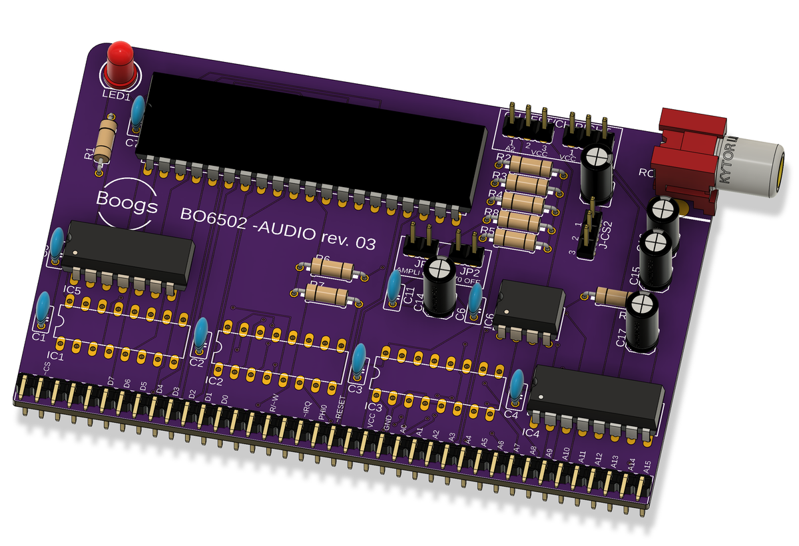
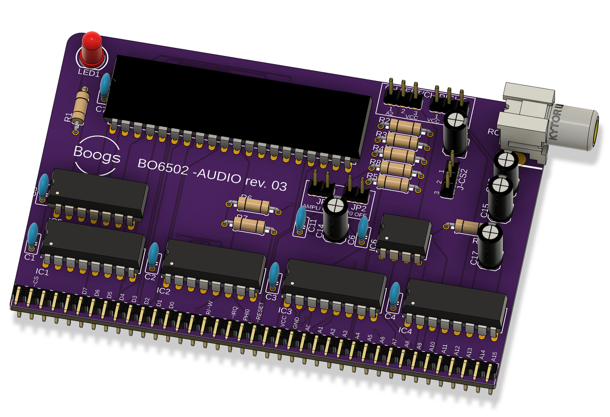

# BO6502 Sound Module

Sound board for the BO6502 system, built around one **General Instrument AY-3-8910** Programmable Sound Generator (3 voices, noise, envelope).

**One PCB, two channels.** The same board is built twice and the jumpers decide whether it is the **right** or the **left** channel. The idea was to separate the two channels and see whether a single printed design could serve both, saving on PCB production.

| Right channel (red RCA) | Left channel (white RCA) |
| :---: | :---: |
|  |  |

On the right board IC1, IC2 and IC3 are not fitted.

---

## 🔊 Stereo with two boards

| Channel | J-CS0 | J-CS1 | Latch address | Write data | Read data |
| :--- | :---: | :---: | :---: | :---: | :---: |
| **Right** | 2-3 | 2-3 | `$D1C0` | `$D1C1` | `$D1C2` |
| **Left** | 1-2 | 1-2 | `$D1C4` | `$D1C5` | `$D1C6` |

J-CS0 and J-CS1 must always be set to the same channel.

### Shared chip select on SPARE2

The address is decoded **on the left board only**. The resulting chip select (`~CS`, active low) travels to the right board on **SPARE2** (pin 38) of the 39-pin bus.

| Part | Left board | Right board |
| :--- | :---: | :---: |
| IC1, IC2, IC3 (address decoder) | fitted | **not fitted** |
| IC4, IC5 (bus control), IC7 (AY-3-8910) | fitted | fitted |

> [!IMPORTANT]
> * Fit IC1-IC3 on the left board only: otherwise two outputs drive the same SPARE2 line.
> * The right board does not work without the left one on the same bus.
> * Do not use SPARE2 for anything else while the sound boards are plugged in.

---

## 🕹️ Address decoding and bus control

* **IC1, IC2, IC3** (74AC138) decode the range `$D1C0-$D1CF` and generate `~CS`. **A3 is not decoded**, so `$D1C8-$D1CF` repeats `$D1C0-$D1C7`.
* **IC4** (74AC138) combines `~CS`, `A0`, `A1`, `R/~W` and `A2` (channel, through J-CS0 and J-CS1).
* **IC5** (74HCT00) turns the IC4 outputs into `BDIR` and `BC1`. `BC2` is tied to VCC.
* The AY clock is **PHI0** from the bus.

| Offset (from the channel base) | Access | BDIR | BC1 | Operation |
| :---: | :---: | :---: | :---: | :--- |
| +0 | write | 1 | 1 | latch the register number |
| +1 | write | 1 | 0 | write the register |
| +2 | read | 0 | 1 | read the register |

---

## 🎚️ Output and optional amplifier

**Both final boards:** J-CS2 on 1-2, JP1 open (no amplifier), JP2 closed (470 Ω resistor out).

The three AY channels are mixed (R2, R3, R4) to a single **RCA** socket, one per board. An **LM386** amplifier stage was added in case it is needed. The two final boards do not use it.

| Jumper | Setting | Effect |
| :--- | :--- | :--- |
| **J-CS2** | 1-2 | direct output to the RCA socket |
| **J-CS2** | 2-3 | amplified output to the RCA socket |
| **JP1** (AMPLI ON) | closed | feeds the LM386 input |
| **JP2** (R470 OFF) | closed | bypasses the 470 Ω series resistor (R5) of the direct output |
| **JP2** (R470 OFF) | open | R5 in series with the direct output |

The extra jumpers are there to try other configurations according to needs.

---

## 📐 Technical specifications

| Specification | Detail |
| :--- | :--- |
| **Sound chip** | 1x AY-3-8910 per board |
| **Logic** | 4x 74AC138, 1x 74HCT00 (right board: 1x 74AC138, 1x 74HCT00) |
| **Amplifier** | 1x LM386 (optional) |
| **Output** | 1x RCA per board |
| **Bus connector** | 39-pin (36 active + 3 spare, SPARE2 used for `~CS`) |

---

## 📁 Files

| File | Content |
| :--- | :--- |
| [`eagle/AUDIO_final_rev03.sch`](eagle/AUDIO_final_rev03.sch), [`.brd`](eagle/AUDIO_final_rev03.brd) | EAGLE schematic and board, **rev. 03** (final) |
| [`export/BO6502-AUDIO_021.pdf`](export/BO6502-AUDIO_021.pdf) | schematic sheet of rev. 03 (internal file number 021) |
| `eagle/AUDIO_005.*`, `export/BO6502-AUDIO_005.pdf` | superseded version with two AY chips on one board |

---

## 🎬 Video

How the board works and how to program it (4:40, with subtitles). Click a picture to watch it on YouTube.

<table><tr>
<td align="center"> Italiano</td>
<td align="center"> English</td>
</tr></table>

---

## 📂 Related modules
* 🏗️ **[Backplate System](../BO6502%20BACKPLATE/README.md)**: main bus backbone.
* 🧠 **[CPU Module](../BO6502%20CPU/README.md)**: system processing unit.

---

## 🏭 Gerber files

Ready for PCB manufacturing (2 layers, drill file included). The drill hits of each file have been checked against its EAGLE board.

| Gerber (ZIP) | Exported from |
| :--- | :--- |
| [`BO6502_AUDIO_gerber.zip`](export/BO6502_AUDIO_gerber.zip) | `AUDIO_final_rev03.brd` |

---
© 2026 Boogs77 | Engineered for the 6502 enthusiast.
